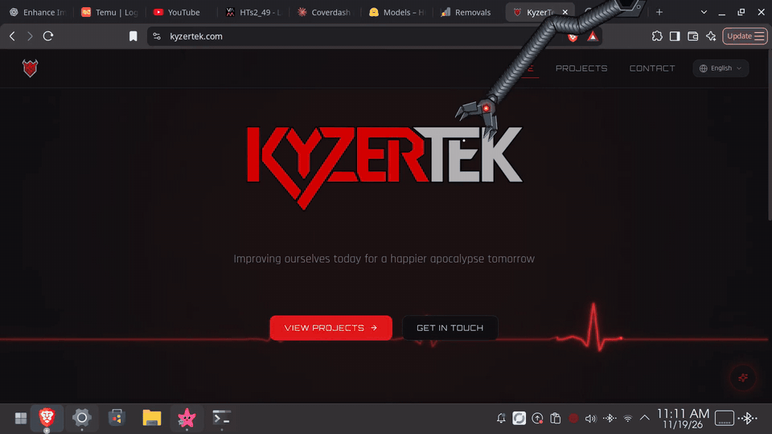

# Tendril Cursor

**Your mouse pointer, replaced by a robotic arm.** A claw holds the exact
point you're pointing at. An armoured arm trails back to a mount on the
edge of your screen. The arm follows the path you took, like a beam that cuts
sharp angles: a straight move stays straight, a winding move leaves angled
bends that hold their place, and the base slowly reels them back in.



- **Try it in your browser, no install:** <https://theinsidiousmachine.github.io/tendril-cursor/>
- **Full demo video (56 s):** [Releases](https://github.com/TheInsidiousMachine/tendril-cursor/releases/latest)
- **Project page:** <https://kyzertek.com/projects/tendril-cursor>

It runs inside KDE Plasma's compositor (KWin, Wayland), so the arm can reach
across the whole monitor. It isn't stuck inside a tiny cursor image.

---

## Install (KDE Plasma 6 on Wayland)

```bash
git clone https://github.com/TheInsidiousMachine/tendril-cursor.git
cd tendril-cursor
./install.sh          # builds and installs (asks for sudo once)
tendril-cursor on     # use it as your cursor
```

| Do this | Command | Or press Alt+Space and type |
|---|---|---|
| Turn it on | `tendril-cursor on` | Tendril Cursor On |
| **Turn it off** (your old cursor comes back) | `tendril-cursor off` | Tendril Cursor Off |
| Adjust it live | `tendril-cursor tune` | Tendril Cursor Settings |
| Try it without hiding your normal cursor | `tendril-cursor try` | |
| Check what's running | `tendril-cursor status` | |

**Build requirements** (Fedora package names, other distros are similar):
`cmake extra-cmake-modules gcc-c++ kwin-devel qt6-qtbase-devel qt6-qtdeclarative-devel kf6-kcoreaddons-devel`.
`tendril-cursor on` also uses `spectacle` and ImageMagick (`magick`) for a
safety check (see below). Tested on KWin 6.7.5 (Plasma 6.7, Fedora 44).

**Safety:** `tendril-cursor on` takes a screenshot before and after loading
the effect. If most of the screen changed (for example, it went black), it
unloads the effect at once and leaves your normal cursor alone.

## Adjust it

Run `tendril-cursor tune`. A settings page opens in your browser. Every
slider changes the cursor on your desktop immediately, with no restart. The
main sliders are:

| Slider | What it changes |
|---|---|
| **Bend sensitivity** | How much your path must curve before the arm takes a corner. Low = many small cuts, high = a few big ones. |
| **Hold** | How long a bend stays put before the base starts reeling it in. |
| **Reel speed** | How fast the base reels the bends in. |
| **Loop close time** | How long a loop takes to pull tight when the arm crosses its own path. |
| **Rest bends** | How many of your path's bends the arm keeps once it settles (0 = it straightens out). |
| **Thickness** | How thick the arm is. |

Everything else is under **Advanced**. Settings are saved in
`~/.config/tendril-cursor/params.json` (`{}` = defaults), and you can edit
that file by hand too. The full list is in [docs/tuning.md](docs/tuning.md).

## How it works (short version)

- The claw's tip **is** the pointer, to the pixel. Clicking still hits
  exactly what you aim at.
- The arm is a short list of corners pinned in place on the screen. A corner
  is added only where your path really turns, so straight moves stay straight.
- The mount on the screen edge reels corners in, oldest first, and keeps the
  last couple, so the arm rests in the shape it arrived in.
- It can't tangle. There are only so many corners and the arm has a maximum
  length. If the arm touches itself, that loop pulls shut.
- Each screen is drawn once per display refresh, in sync with the
  compositor. It stops drawing completely when nothing moves.

Details: [docs/how-it-works.md](docs/how-it-works.md).

## Repository layout

| Path | What's in it |
|---|---|
| `core/tendril_core.js` | The arm's behaviour (pure JavaScript, no dependencies) |
| `core/tendril_render.js` | Drawing (Canvas 2D) |
| `qml/` | The QtQuick view that KWin hosts |
| `src/` | The KWin effect (C++): overlay scenes, pointer input, live settings |
| `tendril-bench.html` | Browser playground and settings page (same model and drawing code) |
| `tools/` | The `tendril-cursor` command, the settings server, KRunner launchers |
| `cursor-theme/` | The invisible cursor theme that hides the normal pointer |
| `test/` | Simulation and soak tests, plus a QML smoke test |

The same two JS files drive the browser playground, the tests and the
desktop effect, so what you see in the browser is what you get on the desktop.

## Tests

```bash
test/run.sh   # 15-path simulation, 180,000-frame soak at several resolutions, QML smoke test
```

Requires `node`, plus Qt's `qml` runner for the smoke test.

## For AI agents and tools

Read [AGENTS.md](AGENTS.md). It covers the architecture, the contracts that
must not break, how to verify changes, and the known pitfalls.

## License

MIT. See [LICENSE](LICENSE).
